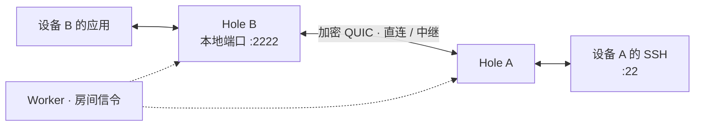

<p align="center">
  
</p>

<h1 align="center">Hole</h1>

<p align="center"><strong>把另一台设备的服务，接到你的本地端口。</strong></p>

<p align="center">TCP / UDP 端口映射 · QUIC 加密传输 · 多端共用核心</p>

<p align="center">
  <a href="#快速开始">快速开始</a> ·
  <a href="#客户端与构建">选择客户端</a> ·
  <a href="#连接路径">连接原理</a> ·
  <a href="#文档">文档索引</a>
</p>

两台设备加入同一个房间，即可映射 SSH、开发服务或其他 TCP / UDP 应用。

## 能做什么

| 能力 | 说明 |
| --- | --- |
| **双向端口映射** | 同时提供和访问多条 TCP / UDP 服务。 |
| **加密数据通道** | 每对设备共用一条 QUIC，承载映射与语音；默认使用 BBR 拥塞控制。 |
| **直连与中继** | 优先尝试 IPv4 / IPv6 UDP 直连，失败后按配置使用 Hole / TURN 中继。 |
| **TCP 会话恢复** | 同一进程内切网或传输重连时，可恢复仍存活的 TCP 会话。 |
| **可选语音房** | 同一房间最多 8 台启用语音的设备参与。 |
| **网络诊断** | 查看 NAT 类型、端口可预测性、端口映射与连接状态。 |

<details>
<summary>语音开关与 BBR 说明</summary>

- **语音**：设置 `voice.enabled: true`，同一房间最多 8 台语音设备参与。音频设备与操作方式见各客户端说明。
- **BBR**：共享核心的设备 QUIC 连接默认使用标准 BBR，覆盖 ICE、预测打洞、固定入口、设备中继和旧 IPv6；无需修改系统 TCP 参数，不保证任意网络都提速。实现和依赖来源见 [QUIC BBR 说明](core/internal/congestion/README.md)。

</details>

## 客户端与构建

| 客户端 | 特点 | 从源码构建 |
| --- | --- | --- |
| [CLI](#快速开始) | Go 命令行；支持固定入口和运行 Hole 中继 | `./build.sh cli` |
| [Android](android/README.md) | 原生应用，支持配置交换、语音与连接报告 | `./build.sh android` |
| [Wear OS](android/wear/README.md) | 独立运行，共用手机源码与 Go 核心 | `./build.sh wear` |
| [桌面](desktop/README.md) | Linux / Windows，Rust + Slint，内嵌 Go 核心 | `./build.sh desktop` |
| [PenMods](penmods/README.md) | 使用 `hole-core` 的插件 | [插件构建说明](penmods/README.md#构建) |

构建产物放在 `dist/`。`./build.sh all` 构建 CLI、Android 手机和 Wear，不包含桌面或独立核心宿主。工具链、签名与验证方法见 [构建指南](docs/BUILDING.md)。

## 快速开始

以 **设备 A 提供 SSH，设备 B 通过本地 `2222` 端口访问** 为例。

准备 Go 1.27.3、Bash、Python 3，以及一个可用的 [Hole Worker](docs/WORKER.md)。图形客户端的操作入口见上方客户端说明。

### 1. 构建并准备配置

在仓库根目录构建 CLI，并从完整示例复制配置：

```bash
./build.sh cli
cp -n config.example.yaml config.yaml
```

### 2. 加入同一房间

两端编辑各自的 `config.yaml`：前四项保持一致，`device_name` 各不相同。

```yaml
server_url: wss://HOST/ws
room: my-room
password: SIGNAL_PASSWORD  # Worker 信令密钥
token: ROOM_PASSWORD       # 房间口令
device_name: device-a      # 设备 B 改为 device-b
transport:
  preferred: ice
```

### 3. 配对服务

删除示例中本端不需要的映射项，两端使用相同的服务 `id`。

**设备 A · 提供 SSH**（本机 SSH 服务监听 `22` 端口）：

```yaml
provide:
  - id: ssh
    service: tcp://127.0.0.1:22
```

**设备 B · 使用 SSH**：

```yaml
consume:
  - id: ssh
    expose: 127.0.0.1:2222
```

### 4. 启动并访问

两端分别启动 CLI（以下以 Linux amd64 为例，其他平台使用 `dist/cli/` 中对应文件）：

```bash
./dist/cli/hole-linux-amd64 -config config.yaml
```

在设备 B 上连接，把 `USER` 换成设备 A 的 SSH 用户名：

```bash
ssh -p 2222 USER@127.0.0.1
```

`service` 和 `expose` 支持 TCP 与 UDP。完整字段见 [配置示例](config.example.yaml)。

<details>
<summary>常用 CLI 参数</summary>

| 参数 | 作用 |
| --- | --- |
| `-config FILE` | 指定配置文件；默认读取当前目录的 `config.yaml`。 |
| `-transport VALUE` | 可选 `auto`、`ice` 或 `ipv6`；`auto` 使用 ICE 并兼容旧 IPv6 对端。 |
| `-debug` | 输出连接协商和底层网络错误，日志可能包含服务器及候选地址。 |
| `-version` | 显示共享核心版本。 |

</details>

CLI 默认使用 [fsnotify](https://github.com/fsnotify/fsnotify) 监听 `-config` 指定的文件（默认 `config.yaml`）。保存后等待约 200 毫秒合并连续写入，校验通过后在当前引擎中热重载，无需重启进程；支持直接写入、原子替换保存以及文件删除后重新创建。命令行的 `-transport`、`-allow-insecure-signal` 覆盖规则在每次重载时仍然有效。仅修改注释或保存相同的有效配置不会触发连接更新；文件暂时不可读或配置无效时会输出警告并继续使用旧配置，修正后再次保存即可。

热重载保留未受影响的 TCP / UDP 应用会话。新版 Worker 支持 ICE 在线更新映射声明：增删映射、修改服务目标／协议或本地监听地址，只重建受影响的映射通道和应用连接，保留已有设备间的共享 QUIC 和信令连接；新增设备关系仍需建连，删除最后一条映射且不再使用语音时释放设备连接。双方均支持在线配置协议时，语音开关也复用现有 QUIC。

`session_timeout` 在本地更新；STUN／NAT STUN、打洞预算及探测、收集、连通性检查和重试等待参数用于后续尝试，不主动打断已连通路径。中继策略、网卡限制、固定入口等传输选项变化仍会按需更新路径，启用仅中继会立即撤销不符合要求的直连。更改 `server_url`、房间、密码、令牌、设备名或有效传输模式会重新认证并关闭原有会话。旧 Worker 或正在使用旧 IPv6 映射时，声明更新回退到重新加入房间；旧对端的语音开关会重建该设备对的传输。

## 连接路径



Hole 以端口为单位转发，不创建 VPN / TUN。Worker 负责房间信令和按需签发 TURN 凭据，**不转发业务数据**。

普通 ICE 连接按顺序尝试，成功后即使用该路径：

| 顺序 | 路径 | 何时尝试 |
| --- | --- | --- |
| ① | **普通 ICE 直连** | 首先尝试 IPv4 / IPv6 UDP，不等待 NAT 分类结果。 |
| ② | **按 NAT 类型打洞** | ICE 失败后，双方客户端与 Worker 支持新能力且证据适用时尝试。 |
| ③ | **Hole / TURN 中继** | 直连方式耗尽后，按 `relay.order` 尝试可用中继。 |

配置了 Hole 中继时，默认顺序为 **Hole → TURN/UDP → TURN/TCP → TURN/TLS**。

<details>
<summary>传输模式、仅中继与旧端兼容</summary>

| `transport.preferred` | 行为 |
| --- | --- |
| `ice` | 使用 ICE。 |
| `auto` | 使用 ICE，并兼容旧 IPv6 对端。 |
| `ipv6` 或省略设置 | 只使用旧 IPv6 路径。 |

- `allow_legacy` 用于协商旧对端，不是 ICE 失败后的自动回退开关。
- `ice.relay_only: true` 跳过直连，仅使用可用的 Hole 或 TURN；Worker 和客户端均需支持该策略。
- ICE 失败后的分类打洞需要同时更新 Worker 和两端客户端，协商 `nat-punch-v1` 与 `ice-first-v1`。未协商时仍先尝试普通 ICE，失败后进入中继。
- 关闭 NAT 分类或 IPv4 不适用时，保留首次普通 ICE（包括 IPv6），失败后跳过分类打洞。

详见 [传输选择](docs/PROTOCOL.md#传输选择) 与 [ICE 协商](docs/PROTOCOL.md#ice-直连nat-状态与端口映射)。

</details>

## NAT 探测与 UDP 端口映射

允许直连时，Hole 可自动为隧道 UDP 端口申请临时路由器映射：先尝试 UPnP IGD，再尝试 NAT-PMP。映射不可用时，继续其他直连或中继路径。

| 配置 | 默认值 | 作用 |
| --- | --- | --- |
| `ice.port_mapping` | `auto` | 自动申请隧道端口映射；`off` 禁用。不会映射 `provide` / `consume` 的业务端口。 |
| `ice.nat_stun_urls` | `null` | NAT 分类服务：`null` 复用 `ice.stun_urls` 并补充默认服务；`[]` 关闭；自定义最多 8 条。 |

Android / Wear、桌面和 PenMods 可在设置中调整这些选项，导入导出会保留配置。图形客户端提供 NAT 检测入口；命令行可独立运行：

```bash
source scripts/build-env.sh
go run ./tools/natprobe
```

NAT 类型与端口可预测性用于策略选择和诊断，不保证直连成功。预测重试随机轮换 IPv4 STUN，Binding 失败时更换服务器与校准 socket；双方客户端和 Worker 均支持时，每次校准等待双方准备完成，单端失败也由双方重新校准。分类规则、No-PAT 判断和 JSON 字段见 [NAT 工具说明](tools/README.md)；预测打洞、重试预算与设备调度见 [协议说明](docs/PROTOCOL.md#ice-直连nat-状态与端口映射)。

## 固定入口与设备中继

<details>
<summary>固定入口：已有公网 UDP 地址或路由器端口转发</summary>

有公网 UDP 地址或已配置路由器端口转发时，可给一端设置固定入口：

```yaml
transport:
  preferred: ice
  fixed_endpoint:
    listen: 0.0.0.0:40000
    advertise: relay.example.com:50000
```

本例将公网 UDP `50000` 转发到本机 UDP `40000`。对端从 Worker 获取公布地址并拨号，无需设置入口。

- **只使用固定路径**：失败后不回退 ICE / TURN，也不能与仅中继模式组合。
- **先升级 Worker，再升级客户端**：两端核心与 Worker 均需支持固定入口协议。
- **入口需要可达**：确认公布地址、端口转发和防火墙规则。
- **通过 CLI 配置监听**：图形客户端可显示固定入口状态。

详见 [固定入口直连](docs/PROTOCOL.md#固定入口直连)。

</details>

<details>
<summary>Hole 设备中继：让同房间 CLI 设备转发数据</summary>

根目录 Go CLI 可把固定入口同时作为同房间设备中继。服务端和客户端需要在同一个房间：

```yaml
# 中继设备
device_name: relay-node
transport:
  preferred: ice
  fixed_endpoint:
    listen: 0.0.0.0:40000
    advertise: relay.example.com:40000
relay:
  serve:
    enabled: true
```

```yaml
# 使用中继的客户端
relay:
  device: relay-node
  order: [hole, udp, tcp, tls]
```

Hole 中继与该设备的固定业务共用 UDP 监听端口，不新开监听端口。中继只转发端到端 QUIC 数据，不连接目标业务服务。服务容量、限速和升级兼容要求见 [协议说明](docs/PROTOCOL.md#hole-设备中继)。

</details>

## 文档

| 我想了解… | 文档 |
| --- | --- |
| YAML 字段与完整配置 | [配置示例](config.example.yaml) |
| 部署信令服务、配置 TURN | [Worker 部署指南](docs/WORKER.md) |
| 工具链、签名、构建产物与验证 | [构建指南](docs/BUILDING.md) |
| 连接协商、固定入口、中继与会话恢复边界 | [协议说明](docs/PROTOCOL.md) |
| NAT 类型、端口趋势与诊断结果 | [NAT 探测工具](tools/README.md) |

Worker 需单独部署，不会随客户端构建自动发布。

---

许可证：[GPL-3.0-only](LICENSE)
